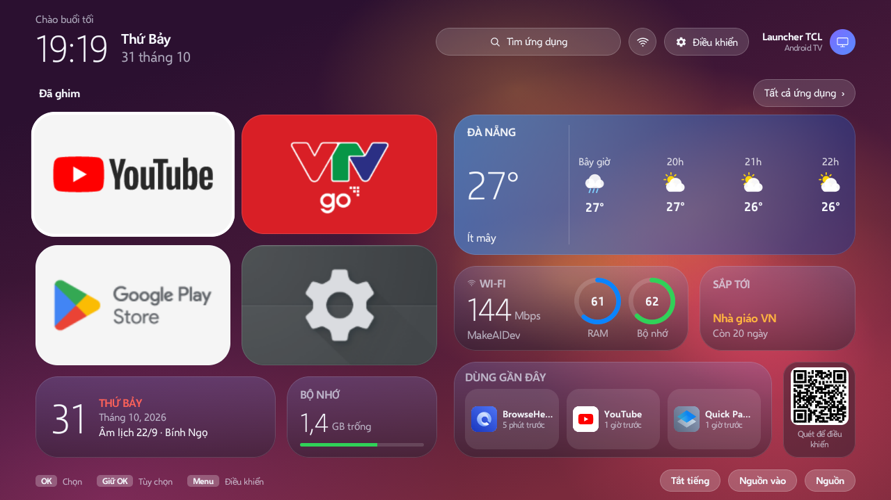

<div align="center">

# Launcher TCL (Vitrine)

**Launcher màn hình chính Android TV kiểu macOS: nhẹ, không quảng cáo, không theo dõi, điều khiển được bằng remote lẫn điện thoại.**
Kèm bộ công cụ **thêm AirPlay cho TV** và bộ script **gỡ bloatware, tăng hiệu năng TV**, tất cả đều không cần root.



</div>

---

Các dòng Android TV và Google TV giá rẻ thường đi kèm launcher đầy quảng cáo và dịch vụ chạy ngầm ngốn RAM.
Launcher TCL thay màn hình chính bằng một giao diện gọn gàng kiểu Google TV: thanh trên cùng có lời chào và giờ lớn, lưới ô kính mờ gồm ứng dụng đã ghim
và các widget, trên nền hình nền đổi màu. Toàn bộ dùng được bằng remote, và có thể
chỉnh từ điện thoại bằng cách quét mã QR.

Nó chỉ dùng mạng cho **một việc**: lấy thời tiết từ Open-Meteo (không cần tài khoản hay khóa API, tối đa 30 phút một lần).
Không phân tích, không quảng cáo, không theo dõi.

## Giao diện

- **Thanh trên cùng:** lời chào theo giờ, giờ lớn và ngày; bên phải là ô *Tìm ứng dụng*, nút Wi‑Fi, nút **Điều khiển**
  và tên TV. Bấm Wi‑Fi hoặc Điều khiển để mở Trung tâm điều khiển.
- **Đã ghim:** bốn ô ngang 2×2 hiện **banner của chính ứng dụng** (YouTube, VTVgo, Play Store...); ứng dụng không có
  banner dùng icon trên nền màu. Ô còn trống là *Thêm ứng dụng*. Nút *Tất cả ứng dụng ›* ở góc phải mở toàn bộ
  ứng dụng có **tìm kiếm khi gõ**. Giữ OK trên ứng dụng để ghim, bỏ ghim, xem thông tin hoặc gỡ cài đặt.
- **Ô thông tin (kính mờ, bật/tắt từng cái):**
  - **Ngày:** ngày dương, thứ, và **âm lịch**.
  - **Thời tiết:** nhiệt độ, tình trạng và dự báo theo giờ. Bấm để xem chi tiết.
  - **Wi‑Fi:** tốc độ, tên mạng, vòng RAM và bộ nhớ.
  - **Bộ nhớ:** dung lượng trống và thanh đã dùng.
  - **Sắp tới:** ngày lễ hoặc sự kiện riêng gần nhất trong 60 ngày.
  - **Dùng gần đây:** các ứng dụng vừa mở, kèm thời gian.
  - **Mã QR** để kết nối điện thoại bất cứ lúc nào.
- **Nút ở đáy màn hình:** cạnh hướng dẫn phím có ba nút sát phải: *Tắt tiếng*, *Nguồn vào* (HDMI...) và *Nguồn*
  (tắt màn hình TV, có hỏi xác nhận).
- **Chế độ nghỉ:** sau 3 phút không bấm phím, hiện giờ lớn, ngày, âm lịch và thời tiết trên nền tối, nhích vị trí mỗi phút
  để tránh cháy màn hình. Bấm phím bất kỳ để thoát.
- **Hiệu ứng nhẹ:** ô đang chọn nổi lên, các ô hiện dần khi mở, số liệu chạy mượt, chuyển màn hình bằng fade.
  Không có hiệu ứng chạy liên tục nên không tốn pin hay làm nóng máy.
- **Lịch:** xem lịch dương và âm, ngày lễ Việt Nam (Tết, Rằm, Giỗ Tổ, Trung thu, Ông Công Ông Táo, Giao thừa...)
  và các sự kiện riêng của bạn.
- **Hình nền:** Sonoma, Hoàng hôn, Đại dương... vẽ sẵn một lần nên không tốn tài nguyên làm mờ. Có thể tải ảnh riêng
  từ điện thoại, chỉnh độ tối và độ trong của widget.
- **Âm thanh giao diện:** dùng chính tiếng điều hướng và tiếng bấm của TV (theo cài đặt "âm thanh hệ thống"), bật/tắt được.

### Trung tâm điều khiển

Mở từ nút **Điều khiển** (hoặc nút Wi‑Fi) trên thanh trên cùng, hoặc bấm phím Menu trên remote:

- Phím tắt vào cài đặt, ngõ vào TV (HDMI...), bật/tắt tiếng giao diện.
- Wi‑Fi (tên mạng, Mbps, dBm), chọn **thành phố thời tiết**, thanh **âm lượng**.
- **Dọn RAM** một lần bấm (cho biết đã giải phóng bao nhiêu MB), hiển thị RAM và bộ nhớ còn trống.
- **Điện thoại:** hiện mã QR to kèm hướng dẫn.

## Điều khiển bằng điện thoại

TV và điện thoại dùng chung một Wi‑Fi, mở camera quét mã QR trên TV, trang web điều khiển mở ra, không cần cài ứng dụng:

- Chọn thành phố, hình nền (kể cả tải ảnh lên), độ tối nền, độ trong widget.
- Sắp xếp ứng dụng ghim, bật/tắt widget, bật/tắt âm thanh.
- Chỉnh âm lượng, dọn RAM, mở ứng dụng trên TV, **tắt màn hình TV** và **chuyển nguồn vào** (HDMI...).
- **Gõ chữ vào TV, phím điều hướng từ xa và tìm kiếm YouTube** ngay trên điện thoại.
- Thêm **sự kiện hằng năm**: sinh nhật (ngày dương) và ngày giỗ (ngày âm), hiện trên widget Thời gian và Lịch.

An toàn: máy chủ chỉ trả lời thiết bị trong mạng nhà, mọi yêu cầu phải kèm khóa ngẫu nhiên nằm trong mã QR.
Bấm **Đổi mã** trên điện thoại để thay khóa. Một dịch vụ nền nhỏ (thông báo im lặng) giữ kết nối khi bạn đang mở
YouTube hay ứng dụng khác.

## Cài đặt

TV dùng trong tài liệu này có IP **192.168.1.30** (thay bằng IP TV của bạn).

1. Trên TV: **Cài đặt → Tùy chọn thiết bị → Giới thiệu**, bấm OK vào *Bản dựng (Build)* bảy lần, rồi bật
   **Tùy chọn nhà phát triển → Gỡ lỗi USB / Gỡ lỗi qua mạng**.
2. Trên máy tính (cần `adb`, JDK 17+ và Android SDK):
   ```bash
   adb connect 192.168.1.30            # chấp nhận hộp thoại trên TV ("Luôn cho phép")
   ./gradlew assembleRelease           # build bản release
   TV=192.168.1.30 ./tools/install.sh  # cài lên TV
   ```
   `install.sh` cài APK, cấp quyền vị trí (để đọc tên Wi‑Fi) và bật chuyển hướng nút Home. Cập nhật ứng dụng sẽ
   tắt dịch vụ chuyển hướng, nên cứ chạy lại script này mỗi lần cài bản mới.
3. Bấm nút **Home** trên remote: màn hình chính bây giờ là Launcher TCL.

### Trả lại launcher gốc

```bash
TV=192.168.1.30 ./tools/undo-home.sh               # nút Home về launcher gốc (ứng dụng vẫn cài)
TV=192.168.1.30 ./tools/restore-stock-launcher.sh  # bật lại launcher của TV và tắt chuyển hướng
TV=192.168.1.30 ./tools/undo-tweaks.sh             # khôi phục tốc độ hoạt ảnh về 1.0x
```

### Cách đặt làm màn hình chính

| Tùy chọn | Cách làm | Đánh đổi |
|---|---|---|
| **Chuyển hướng** (giữ launcher gốc) | `./tools/install.sh` (dùng dịch vụ trợ năng `HomeRedirectService`) | Launcher gốc vẫn chạy và nháy lên một chút |
| **Thay thế** (nhẹ nhất) | Android TV: `adb shell pm disable-user --user 0 com.google.android.tvlauncher`. Google TV: tắt `com.google.android.apps.tv.launcherx` **và** `com.google.android.tungsten.setupwraith` | Tiết kiệm 30–145 MB RAM; hoàn tác bằng `pm enable` |

## Quyền ứng dụng

| Quyền | Dùng để |
|---|---|
| `INTERNET` | Chỉ để lấy thời tiết (Open-Meteo) |
| `ACCESS_WIFI_STATE`, `ACCESS_FINE_LOCATION` | Đọc tên và tốc độ Wi‑Fi (Android ẩn tên mạng nếu không có quyền vị trí) |
| `KILL_BACKGROUND_PROCESSES` | Nút **Dọn RAM** |
| `FOREGROUND_SERVICE` | Giữ máy chủ điện thoại chạy khi đang ở ứng dụng khác |
| `REQUEST_DELETE_PACKAGES` | Tùy chọn *Gỡ cài đặt* khi giữ OK trên ứng dụng |

## Thêm AirPlay cho TV

TV hiện trong **Phản chiếu màn hình** trên iPhone, iPad, Mac, ẩn hoàn toàn và chạy từ lúc khởi động, giống Chromecast.

```bash
TV=192.168.1.30 NAME="TV Phòng khách" ./airplay/install-airplay.sh
```

Script build [android-airplay-server](https://github.com/jqssun/android-airplay-server) (UxPlay) kèm bản vá TV.
Chi tiết: [airplay/README.md](airplay/README.md).

## Gỡ bloatware và tăng hiệu năng TV

Mọi thao tác an toàn và hoàn tác được (luôn dùng `pm disable-user`, không gỡ cài đặt, không động đến firmware):

```bash
cd tools
TV=192.168.1.30 ./measure.sh baseline                        # chụp trạng thái: RAM, bộ nhớ, gói, tiến trình
TV=192.168.1.30 ./debloat.sh com.vendor.ads com.vendor.demo  # tối đa 10 gói mỗi lượt, có log, từ chối ứng dụng lõi
adb -s 192.168.1.30:5555 reboot && TV=192.168.1.30 ./health.sh  # sau mỗi lượt: home, Wi‑Fi, ngõ vào, cast, crash
TV=192.168.1.30 ./tweaks.sh --apply                          # hoạt ảnh 0.5x, dọn cache, đóng ứng dụng nền
TV=192.168.1.30 ./measure.sh after                           # so sánh với baseline
TV=192.168.1.30 ./debloat.sh --undo                          # khôi phục tất cả
```

Nên tắt gì, không được động vào gì, sửa lỗi mất HDMI ARC, và vì sao không nên mở khóa bootloader:
**[docs/PLAYBOOK.md](docs/PLAYBOOK.md)**.

## Cấu trúc mã nguồn

| Tệp | Vai trò |
|---|---|
| `Home.kt` | Màn hình chính: lưới ô, thanh trên cùng, Lịch, Thời tiết, Trung tâm điều khiển, màn hình QR |
| `Ui.kt`, `Widgets.kt` | Hình nền, kính mờ, danh sách ứng dụng, tìm kiếm |
| `Apps.kt` | Danh sách ứng dụng, ghim, cài đặt |
| `Weather.kt` | Thời tiết Open-Meteo, danh sách thành phố, bộ nhớ đệm |
| `Lunar.kt`, `Holidays.kt`, `Events.kt` | Âm lịch Việt Nam, ngày lễ, sự kiện riêng (sinh nhật, giỗ) |
| `Stats.kt` | Số liệu RAM, bộ nhớ, Wi‑Fi, băng thông |
| `PhoneServer.kt`, `assets/phone/` | Máy chủ web và trang điều khiển trên điện thoại |
| `KeepAliveService.kt` | Giữ máy chủ điện thoại chạy nền |
| `HomeRedirectService.kt` | Chuyển hướng nút Home |
| `Sfx.kt` | Âm thanh giao diện của TV |

## Câu hỏi thường gặp

**Có cần root không?** Không. Chỉ dùng lệnh ADB tiêu chuẩn, hoàn tác được, và khôi phục cài đặt gốc luôn đưa TV về ban đầu.

**Các ứng dụng của tôi vẫn chạy chứ?** Có. Chỉ màn hình chính bị thay; YouTube, Netflix, Play Store, ngõ vào và
Chromecast không bị ảnh hưởng.

**Hỗ trợ TV nào?** Làm và thử trên TV 4K giá rẻ chip MediaTek/MStar (Android 11, RAM 1,3–1,7 GB). Nên chạy được trên
mọi Android TV hoặc Google TV từ Android 11 trở lên.

**Điện thoại không kết nối được?** Kiểm tra cùng Wi‑Fi, và mở lại mã QR (khóa có thể đã được đổi).

## Giấy phép

Mã nguồn dùng giấy phép **MIT** (xem [LICENSE](LICENSE)). Phông chữ Selawik © Microsoft, theo SIL Open Font
License 1.1 (`app/src/main/assets/Selawik-LICENSE.txt`). Bộ AirPlay trong `airplay/` sửa đổi một dự án
GPL-3.0 nên theo GPL-3.0 (xem [airplay/LICENSE](airplay/LICENSE)).
